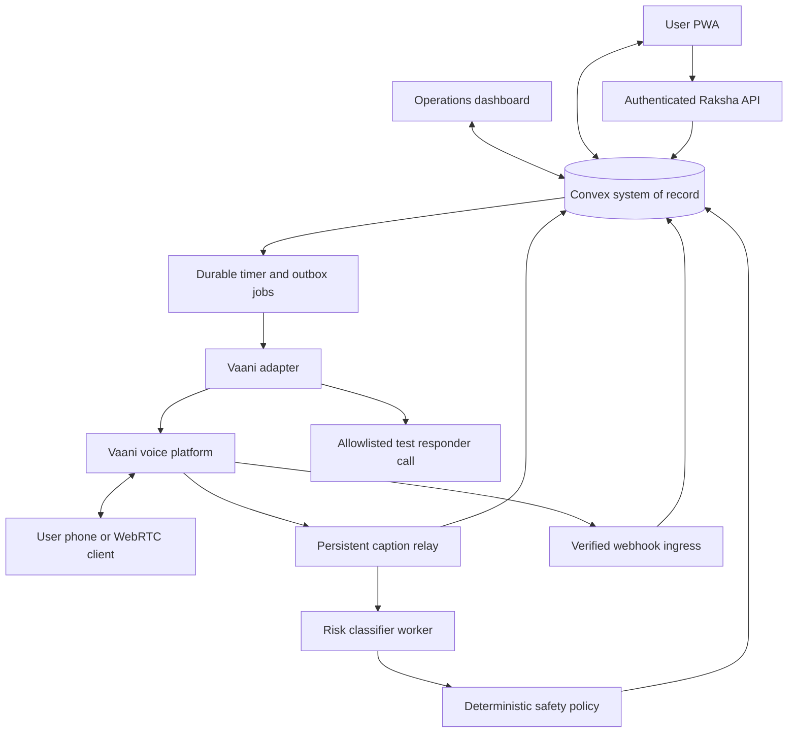

# Raksha — Product Requirements Document

**AI women's safety, call-first PWA and live operations dashboard**  
Version: 1.1 · Updated: 31 October 2026 · Timezone: Asia/Kolkata (IST)  
Status: implementation specification for a controlled hackathon prototype; not a production safety certification.

## 1. Purpose, evidence, and interpretation

Raksha lets a woman who feels unsafe initiate a real phone conversation, monitors the available conversation for contextual concerns, asks for safety confirmation when appropriate, and executes a predefined, consented escalation workflow when she requests SOS or cannot confirm safety. Its central demonstration is a real Vaani call, genuine live transcription, evidence-linked assessments, a server-controlled check-in countdown, and a verifiable alert to a consenting test responder.

This is a practical safety workflow, **not a companionship or reassurance product**. Natural conversation is an interface that supports the workflow. The system must not promise protection, prevention of violence, continuous surveillance, or guaranteed emergency response.

### Revision 1.1

Incorporates the full written Vaani documentation review (55 discovered pages plus OpenAPI) and the user's custom-tool screenshot at 14:50:32. Adds cURL-import setup, webhook signing details with scoped verification, a WebRTC integration choice, provider termination/guardrail tests, and corrections for inconsistent API examples. No repository implementation or live integration is asserted as verified.

### 1.1 Source hierarchy

1. Latest explicit user decisions in [Hackathon Strategy Advice](chatgpt-conversation://6ae59614-5378-83e8-9486-1af634434b30).
2. Earlier user requirements that were not superseded.
3. Vaani and other official documentation inspected for this PRD.
4. Proposed implementation defaults in this document, identified as proposals rather than prior agreements.

The full available conversation was retrieved, including the original product idea, interface discussion, hackathon brief, and subsequent corrections. The attached screenshot `Screenshot 2026-10-31 at 14.28.59.png` was visually inspected. Documentation verification means a capability is described publicly; it does **not** mean a real call or integration was tested.

The supplied [RakshaAgent repository](https://github.com/Sreevarsh-Mahesh/RakshaAgent) returned an inaccessible/404 result through the public reader. No repository implementation, dependencies, database, tests, deployment, or emergency-service integration has been verified. This PRD must not be presented as a description of completed software.

### 1.2 Decision ledger

| Topic | Final direction | Provenance / qualification |
|---|---|---|
| Name | Raksha | User decision; supersedes “Saheli” |
| Product | Action-oriented women's safety system | User rejected companionship framing |
| Primary entry | Tap “Feeling Unsafe” → Raksha calls the registered phone | Latest user decision; user still answers normally |
| Secondary entry | In-app WebRTC voice | Requested; implement after the primary call works |
| Phone dialer | “Call Raksha” opens the assigned number | Backup and judge entry; inbound setup must be tested |
| Interfaces | Mobile-first PWA and landscape operations dashboard | Explicit user requirement |
| Dashboard centerpiece | Live transcript, alongside risk evidence and actual actions | Explicit user priority |
| Detection | Context-aware assessment without requiring a trigger word | User requirement; evidence-limited, not guaranteed detection |
| Modes | Automatic transitions between monitoring, concern, check-in, and SOS | Supersedes rigid user-selected Mode A / Mode B |
| Trigger phrases | Optional custom discreet phrase, suggested phrases, explicit SOS | Original requirement retained; isolated “help” is not always SOS |
| Silence | “Are you feeling safe?” countdown and predefined missed-check-in policy | User requirement; silence is uncertainty, not proof of attack |
| Score | Experimental 0.65 check-in threshold | Proposal reflecting user's 60–70% suggestion; not a calibrated probability |
| Responder identity | Disclose automated assistant acting on the user's behalf | Reject impersonating the user or inventing first-person experiences |
| Police integration | Outside demo scope; test responders only | No automatic real emergency-service calls |
| Database | Convex default for a new hackathon build | Latest conversation recommendation, not a confirmed existing deployment |
| WhatsApp | Remove from critical path; optional later adapter | Latest discussion; no Twilio dependency required for MVP |
| Audio environment | Future research, contingent on authorized raw audio access and evaluation | Text reasoning cannot recover unheard acoustic events |
| Native apps / hardware hotkey | Deferred | PWA now; foreground shortcut and home-screen entry only |

### 1.3 Document conventions

**MUST** is a release requirement for its assigned priority. **SHOULD** is recommended but can be deferred with a recorded reason. **P0** is the core demo gate; **P1** follows the working core; **P2** is deferred. All numeric timing, retention, capacity, and score values below are proposed prototype defaults, not scientifically validated safety thresholds or provider guarantees.

## 2. Product outcomes and boundaries

### 2.1 Users

- **Registered user:** supplies minimal identity, verified test phone, permissions, and an escalation policy; starts calls, responds to check-ins, or requests silent SOS.
- **Operations demonstrator:** authenticated team member sees authorized sessions and investigates delivery failures. The dashboard does not imply a staffed 24/7 monitoring service.
- **Consenting test responder:** teammate who receives a clearly identified test incident and acknowledges receipt.
- **Judge / unknown inbound caller:** may call the published demo number without an account; receives an isolated demonstration session with no access to another user's data.
- **Administrator:** configures the test allowlist, credentials, policy versions, models, and operator access.

### 2.2 Success definition

A user taps the primary action; her phone rings; after answering, real speech appears on the dashboard. An escalating scenario causes an evidence-linked check-in without a trigger word. A safe response cancels the countdown. A deliberate second scenario with no confirmation creates one incident, calls the allowlisted responder, and shows the real outcome. Manual SOS works independently of the classifier and voice provider's availability, subject to Raksha backend connectivity.

Prototype evaluation targets:

| Measure | Target / interpretation |
|---|---|
| Session persistence | One active session per user; no duplicate call from repeated taps |
| Display latency | Final segment visible within 2 seconds of backend receipt, p95 in demo tests |
| Assessment latency | Completed assessment within 5 seconds of accepted final-segment ingestion, p95 |
| Manual SOS | Incident persisted within 2 seconds of authenticated backend receipt, p95 |
| Countdown execution | Expiry processed within 2 seconds of deadline under normal test load; delayed execution observable |
| Delivery honesty | Every attempted external action has pending, accepted, failed, or acknowledged evidence |
| Demo reliability | Three consecutive successful core rehearsals plus the failure cases in Section 18 |
| Privacy | Zero unauthorized cross-user reads or non-allowlisted outbound calls in tests |

Measure call ringing and answer latency separately; neither is guaranteed by Raksha. Do not score the prototype by alleged assaults prevented, emotion-reading accuracy, or percentage probability of violence.

### 2.3 Non-goals

No real police dispatch, emergency-number automation, guaranteed rescue, device-wide hotkey, always-on background microphone, covert tracking, voice impersonation, diagnosis, facial analysis, native mobile app, automatic environmental sound classification, or public incident dashboard. No slide deck or app implementation is delivered by this PRD itself.

## 3. Scope and implementation sequence

| Priority | Requirement | Exit evidence |
|---|---|---|
| P0 | Controlled test identity, authentication, contact consent, outbound allowlist | Negative authorization tests pass |
| P0 | Vaani outbound call from “Feeling Unsafe” | Real consenting user's phone rings and answers |
| P0 | Live caption ingestion and transcript-led dashboard | Real final and interim segments, timestamps, connection status |
| P0 | Deterministic SOS and durable incident/outbox | Single incident despite duplicate triggers |
| P0 | Context classifier and automatic risk check-in | Unscripted concern produces cited evidence and countdown |
| P0 | Silence/missed-confirmation countdown | Healthy silence distinguished from stream failure; server expiry survives page closure |
| P0 | Test-responder handoff | Second consenting phone receives disclosed test call; outcome recorded |
| P0 | PWA control screen and location freshness | Honest denied/unavailable/stale states; no GPS dependency for SOS |
| P0 | Callable inbound demo number for judging | Unknown caller isolated; no fabricated identity/location |
| P1 | WebRTC secondary session | Microphone consent, audio connection, captions, disconnect recovery tested |
| P1 | Direct dialer backup and install affordance | Assigned number works; home-screen entry documented |
| P1 | Custom trigger phrase and rehearsal | User selects and tests phrase; ambiguity handling demonstrated |
| P1 | Web push, session export, safe-arrival timer | Supplementary functionality only |
| P2 | SMS/WhatsApp, multilingual expansion, raw-audio analysis, native app | Separate validation and consent gates |

Build in this order: access controls and session records → real outbound call → relay and transcript → manual SOS/test responder → risk and silence check-ins → dashboard polish → inbound judging verification → WebRTC → optional additions. If a P0 integration fails, label the submission an incomplete prototype and demonstrate only what works. Recorded/replayed events must be visibly marked; never fill a “Live” panel with scripted data.

## 4. Core journeys

### 4.1 Registration and preparedness

1. Authenticate with a chosen identity provider; collect display name, phone, preferred language, and optional relevant emergency notes. Do not collect government ID or medical details by default.
2. Verify phone ownership through an implemented verification mechanism. For the controlled demo, an administrator may explicitly verify a consenting teammate and record method/time; do not label that “OTP verified.”
3. Add one or two consenting test contacts. Contact inclusion requires recipient agreement, test allowlist membership, and an active channel.
4. Explain call transcription, operator visibility, location collection, notification limitations, and test-only escalation separately.
5. Select whether unanswered safety check-ins may alert the configured test contacts. Save consent version and time.
6. Offer geolocation permission with a reason, notification permission on a user gesture, and microphone permission only for WebRTC. A telephony call does not require the PWA microphone.
7. Optionally select/rehearse a discreet phrase. Offer ordinary memorable phrases; never silently assign a random secret phrase.
8. Show readiness: phone verified, test contact ready, location available/denied, notification available/denied, and clearly labeled demo status.

Permission refusal must not block manual SOS incident creation or the call request. It does change what data or channel is available.

### 4.2 Primary “Feeling Unsafe” → incoming phone call

1. User taps **Feeling Unsafe · Call me**. An adjacent description explains that Raksha will ring her phone.
2. Client submits an idempotent session request. Backend binds user, policy snapshot, and a server-selected agent; it never accepts an arbitrary destination number from this request.
3. Request a fresh location asynchronously. Do not delay dispatch waiting for GPS.
4. Backend persists a dispatch job and calls Vaani. UI shows **Requesting call**, then **Call requested**, then **Ringing** only when supported by evidence.
5. User answers in the normal dialer. UI shows **Connected** only after an answer/media event, not dispatch acceptance.
6. Relay ingests captions; classifier evaluates finalized user speech; orchestrator updates safety workflow independently of voice generation.
7. Agent uses short, discreet questions: “Is it okay to talk?” It does not announce precise location, trigger phrase, or contact names aloud unnecessarily.
8. User may confirm safety, request help, use silent SOS in the PWA, or end the call. Ending a call does not silently resolve an incident.

No-answer/rejection: show the outcome, provide explicit retry or WebRTC choice, and never repeatedly redial automatically. A callback request alone does not arm a silence timer. An opted-in scheduled safety check can still operate independently.

### 4.3 WebRTC

User explicitly selects **In-app call**, grants microphone permission, and receives only a session-scoped connection credential from the backend. Show connecting, connected, muted, microphone denied, network failure, and ended states. Do not create an outbound phone call as an invisible fallback. Ask the user to choose the fallback. Avoid simultaneous microphone capture and a phone call in the same safety session.

### 4.4 Direct dialer / inbound judging

“Call Raksha” opens a `tel:` link for the configured demo number; dialer behavior remains under the device's control. Incoming calls create a separate session. Caller ID alone is not authentication for revealing a registered user's profile. A judge can use a short-lived demo session code or remain an anonymous test caller. Unknown callers get no real contact list or inferred GPS, and all escalation routes to the designated test responder. Inbound caption authorization and call/session correlation are explicit integration gates; outbound caption support must not be assumed to prove inbound support.

### 4.5 Context-triggered check-in

Finalized speech such as “Someone has been following me for several streets” and “He's getting closer” can raise concern. The classifier provides evidence and a recommendation; deterministic policy starts one pending check-in. User sees **Are you feeling safe?**, a deadline, **I'm safe**, and **Send SOS**. A discreet spoken prompt supplements the PWA when the call channel supports it. No special word is required for this flow.

### 4.6 Silence-triggered check-in

During an answered call with a healthy event stream, sustained absence of user speech can start a check-in. Agent speech, muting, startup, and declared “I can't talk right now” are handled explicitly. A lost stream is labeled **Monitoring interrupted**, not acoustic silence. Expiry without confirmation follows the previously consented policy and uses the incident reason **Unable to confirm safety**.

### 4.7 Explicit SOS and responder handoff

Silent SOS creates or joins the current incident immediately. It does not wait for a call to connect, a model assessment, a GPS fix, or a confirmation modal. Backend selects the authorized test recipient, prepares minimal factual context, and dispatches a separate responder call. Keep the user call alive if possible; a second call is not a transfer of the user unless separately implemented and tested.

Responder introduction: “This is Raksha, an automated safety assistant. This is a test alert on behalf of a consenting participant.” Then communicate verified identity if authorized, trigger reason, last known location with age/accuracy or “unavailable,” and relevant attributed observations. For nonresponse, say safety could not be confirmed, not that an assault occurred.

A responder answering is not equivalent to accepting responsibility. Record acknowledgement separately through the responder portal or an authenticated tool event. The agent must never claim police were notified or help is on the way.

### 4.8 Resolution and cancellation

An authenticated safe response cancels a pending check-in atomically. If an incident already exists, mark it **User reports safe / resolution requested** and notify the operator; do not erase attempts or pretend delivered alerts were recalled. An operator may resolve a test incident with a reason. Session completion, incident resolution, and call termination remain separate operations.

## 5. PWA UX requirements

Routes: `/onboarding`, `/app`, `/app/session/:id`, `/settings/contacts`, `/settings/safety`, `/history/:id`. Routes are proposed, not existing repository paths.

### Home

- Primary thumb-reachable **Feeling Unsafe · Call me** button.
- Always available **SOS** action, visually distinct and clearly marked test-only in the demo.
- Secondary **In-app call** and **Call Raksha** actions with capability/error states.
- Small readiness summary; no cluttered control-room metrics.
- Optional destination/arrival time, never required before starting assistance.

### Active session

Show actual call state, monitoring freshness, last location age, and the current workflow. Keep **SOS**, **I'm safe**, and **End session** reachable. Transcript is optional on the user screen and hidden by default for discretion. Phone-call mode must explain that the normal dialer hosts the audio. Ending the web session must explain the status of any active incident and verify actual call termination if a provider hang-up action exists.

### Check-in

Use a focused modal/sheet with large controls, text countdown, and deadline derived from server time. Copy: **“Are you feeling safe?”** and **“If you don't respond, Raksha will alert your selected test contact.”** If automatic escalation was not consented to, display the actual alternative. Never show misleading escalation copy.

Do not reset the countdown on refresh, tab switches, arbitrary speech, or background noise. Focus the check-in accessibly without continuously stealing focus from other controls. Screen-reader announcements occur at meaningful intervals rather than every second. Sound/vibration are opt-in; discretion preferences apply to all channels.

### Accessibility and web constraints

Target 44px touch controls, readable contrast, keyboard access, text plus icons for status, reduced motion, and no color-only risk signaling. A foreground `Shift+S` test shortcut may activate SOS only when not typing and when enabled; it is not a global hardware shortcut. Installation is optional; the app must function in a browser.

Geolocation requires permission and a secure context. Notifications have browser-dependent support and permission requirements. These are platform constraints, not evidence of a persistent background safety service. [MDN Geolocation](https://developer.mozilla.org/en-US/docs/Web/API/Geolocation_API), [MDN Notifications](https://developer.mozilla.org/en-US/docs/Web/API/Notifications_API).

Treat background GPS, locked-screen microphone continuity, and notification visibility during a phone call as unguaranteed. Service workers cache only the shell, not private transcripts or locations. Offline UI must say **“Not sent — no connection”**; do not silently queue an SOS for much later and present it as current. Offer the device dialer using a separately verified number/configuration, without claiming Raksha contacted anyone.

## 6. Landscape operations dashboard

Routes: `/ops`, `/ops/session/:id`, `/ops/incidents/:id`, `/ops/config` (admin only).

Desktop target: 1440×900, usable at 1280×720. Tablet fallback stacks panels; phone users are not forced into landscape.

```text
RAKSHA / OPERATIONS      TEST ENVIRONMENT      Feed health / last update
Session list / filters  | Selected session / call status / safety state
-----------------------+-----------------------------------------------
Profile + location     | LIVE TRANSCRIPT (largest) | Risk + check-in
Age and accuracy       | User / agent / unknown   | Evidence references
Consent + readiness    | Interim/final/revisions  | Deadline / limitations
-----------------------+--------------------------+--------------------
Incident delivery state | Action timeline: requested → attempted → outcome
```

Requirements:

- **OPS-01:** Transcript occupies approximately 45–55% of the main workspace. Speaker, relative and absolute time, finality, interruptions, and uncertain transcription are distinguishable. Unknown voices remain unknown.
- **OPS-02:** Auto-scroll pauses when an operator scrolls upward; “Jump to live” restores it. Incoming updates do not destroy text selection.
- **OPS-03:** Risk panel shows concern level, an experimental score label if enabled, evidence snippets linked to segment IDs, limitations, assessment age, model/policy version, and the actual next action.
- **OPS-04:** `agent_thinking` may render “Agent processing.” Never display invented hidden reasoning or claim access to chain of thought.
- **OPS-05:** Map shows a last-known marker and accuracy radius when available, source, age, and stale badge. No animated movement without real updates. Typed location is labeled self-reported.
- **OPS-06:** Timeline records only persisted events: call dispatch, answer, caption connection, assessment, check-in, response, expiry, incident, attempt, provider outcome, acknowledgement, resolution.
- **OPS-07:** Separate “Call connected,” “Monitoring healthy,” and “Incident open.” An answered call can have failed captions; a terminated call can have an unresolved incident.
- **OPS-08:** Filters include active calls, pending check-ins, open incidents, failed deliveries, and degraded feeds. Counts derive from persisted records.
- **OPS-09:** Mask phone numbers by default. Judges see a redacted presentation view; signed URLs, credentials, and private notes never appear on screen recordings.
- **OPS-10:** Operators can request a check-in, acknowledge a failure, or resolve a test incident according to role. Overrides require a reason and audit entry; operators cannot fabricate a user's safe confirmation.

## 7. Vaani integration and capability contract

### 7.1 Verified documentation facts

The [Create Dispatch reference](https://docs.vaanivoice.ai/api-reference/trigger-call) documents `POST /api/trigger-call/`, `medium: telephony|webrtc`, and phone fields `agent_id`, `name`, `contact_number`. Telephony returns `output.call_id` and `output.live_captions_url`; WebRTC returns `token`, `room_name`, `connection_url`, and `live_captions_url`. Caption URLs are signed credentials. Documented stream types include `history`, `transcript`, speaking/turn activity, silence, lifecycle, and heartbeat events. Segments carry IDs, speaker, text, timestamp, finality, index, and confidence. These are documented interfaces; tenant behavior still requires testing.

The [developer overview](https://www.vaani.dev/developers) specifies server-side `X-API-Key` authentication, distinguishes dispatch acceptance from answer/completion, and describes in-call REST tools. It also documents asynchronous post-call processing and configurable idle warning/hang-up behavior.

The [webhook guide](https://docs.vaanivoice.ai/guides/webhook-setup.md), retrieved directly, documents inbound/outbound lifecycle events. In that guide, `call_started` can mean dialing; `user_picked_up_at` represents answer/media. It distinguishes `call_ended` from `call_postprocessing` and uses seconds versus milliseconds respectively for call duration. Normalize units explicitly. Its examples alone do not establish webhook authentication; the campaign-specific signing contract is described in Section 7.4.

### 7.2 Required adapter behavior

- Keep provider API keys server-only. Select agent IDs and destinations server-side.
- Make dispatch an outbox action. Store both Raksha session ID and provider correlation identifiers; do not assume room name and call ID always match.
- The detailed dispatch/BYOL documentation identifies `X-Agent-Id` as optional custom routing/audit metadata forwarded to BYOL, distinct from body `agent_id`. It is not a second authentication credential. Keep the agent UUID in the request body and validate the tenant contract.
- Never enable DND bypass merely because it appears in sample code. Use only approved, opted-in test destinations and account-permitted configuration.
- Normalize the provider's responses into Raksha's own contract. Provider credentials and caption URL never appear in ordinary session queries.
- Host the persistent caption WebSocket relay in a process that supports long-lived connections. Do not hold it in a short-lived web request or assume a database action can run forever.
- Give each relay a bounded lease per call; renew it, recover after a crash, and deduplicate re-delivered events. Reconnect with capped backoff; label gaps and retain previous history.
- When a caption token expires, use only a verified provider recovery/authentication path. If unavailable, mark monitoring degraded; do not invent a token refresh endpoint.
- Capture sanitized sample payloads in integration fixtures. Quarantine unknown event shapes and unmatched identifiers instead of assigning them to the most recent caller.
- Post-call text reconciles the record with provenance; it never retroactively triggers a live SOS for an already closed demo session.

### 7.3 Capability gates before the demo

| Gate | Verification needed | Failure behavior |
|---|---|---|
| Outbound | Account balance, enabled number/carrier, destination permission, actual ring/answer | Offer explicit retry/WebRTC; mark primary demo incomplete |
| Captions | Actual telephony and WebRTC payloads and speaker mapping | Display feed unavailable; do not claim contextual monitoring |
| Inbound | Assigned number, lifecycle correlation, authorized captions | Safe standalone agent; label dashboard limitation |
| Spoken check-in | Validated mechanism to ask during a running call, e.g. agent tool polling/prompt flow | PWA-only check-in is visibly degraded, never claimed delivered through voice |
| Webhook trust | Provider-supported verification or authenticated delivery method | Do not let untrusted webhooks authorize state-changing escalation |
| Responder | Second simultaneous call, capacity, approved recipient, acknowledgement | Record failure; dashboard action required |
| Call termination | Actual supported hang-up mechanism and outcome | Show requested/pending; never falsely show ended |

A signed webhook is preferred. If the account cannot authenticate webhook delivery, use a tested authenticated relay/provider-state reconciliation for consequential transitions, or keep untrusted deliveries observational only. A secret path alone is not equivalent to verified origin. This is an integration blocker to resolve, not a capability asserted by this PRD.

### 7.4 Custom webhook contract and verification

The user confirms that custom webhooks can be configured. Use them for provider event delivery into Raksha; custom tools request actions during conversation. Neither replaces the independent caption relay or server timers.

The [campaign webhook reference](https://docs.vaanivoice.ai/api-reference/campaigns/webhooks.md) documents `X-Vaani-Signature`, `X-Vaani-Timestamp`, and HMAC-SHA256 over the timestamp, a period, and the raw request body. It specifies a five-minute replay check and five delivery attempts with increasing delays. **Confirm secret provisioning and applicability to standalone calls before treating this as the ordinary-call contract.** Also confirm whether retries refresh timestamps and provide stable event IDs.

Ingress MUST verify the tested signature contract before processing, use constant-time comparison, reject malformed/stale requests, deduplicate, durably store accepted events, and then return a prompt 2xx response. Process downstream actions asynchronously. If no stable event ID exists, document and test a deduplication strategy based on provider identity/event content; do not use arrival time as identity. Keep the webhook secret separate from outbound tool credentials.

Guide examples disagree on dotted versus underscore event names and top-level versus nested postprocessing data. Normalize only observed, validated payload variants. A captured payload fixture and negative signature/replay tests are required before consequential webhook-driven transitions.

### 7.5 WebRTC integration choice

Default to the dispatch-based flow already specified, because its caption response is documented. The [Python SDK](https://docs.vaanivoice.ai/sdk.md) additionally documents a managed lifecycle: `sessions.create` → `sessions.connect` → status/events → `sessions.disconnect`, including session TTL and reconnection grace settings. This is an alternative, not an extra layer to mix into dispatch credentials.

Before implementation, the integration lead selects one route and verifies token scopes, expiry, readiness, reconnection, termination, and live-caption availability. The SDK source-install example contains a placeholder repository; verify package provenance/version before use. The API overview's separate WebRTC-token mention is not a complete endpoint contract.

### 7.6 Documentation inconsistencies and client implementation

The [published OpenAPI file](https://docs.vaanivoice.ai/api-reference/openapi.json) contains only five paths and conflicts with the prose on call-details routing and binary recording responses. Do not generate the entire integration from it without corrections and contract tests.

Maintain a small provider adapter with tested fixtures. Supply `contact_number` and `name` for phone dispatch; prefer exported agent UUIDs. Verify greeting-delay units (API text uses seconds where guides discuss milliseconds), model auto-detection field names, and extraction enum keys. Keep browser-session volume options separate from experience-config volume scales. Do not interchange the JSON-import format with REST create-agent configuration. Capture resulting settings to verify partial merges and per-call overrides; never change the global agent configuration for one user's live session.

## 8. Models, agent behavior, and tools

### 8.1 Screenshot and proposed settings

The recovered screenshot shows primary provider **Google**, model **`gemini-3.5-flash`**; fallback provider **Cerebras**, model **`gpt-oss-120b`**; temperature **0.7**, Top P **1.0**, and automatic model selection disabled. This verifies visible selections in a screenshot, not successful calls, currently available model IDs, pricing, or model ownership.

Retain those selections initially if available in the account; verify exact exported IDs before implementation. Proposed conversational temperature: **0.2–0.3**; concise turns, approximately **80–150 output tokens** where supported; interruptible greeting; calm voice; no synthetic background noise by default. The [Persona documentation](https://docs.vaanivoice.ai/getting-started/agent-config/persona.md), fetched directly, describes separate STT/LLM/TTS configuration and recommends low temperatures for consistency. Specific providers/models remain account-dependent.

Test primary and fallback with the same policy. Record which model handled each assessment/call when observable. If fallback activation is not exposed, record it as unknown. Do not describe third-party models as Vaani-proprietary emergency detectors.

### 8.2 Separate responsibilities

- **Conversational model:** short, natural speech; gathers optional context; follows backend tool outcomes; does not independently decide destinations or assert rescue.
- **Risk classifier:** processes available finalized conversation and activity context; returns schema-validated observations, uncertainties, and recommended next step.
- **Deterministic orchestrator:** owns authorization, timers, incidents, escalation, retries, and cancellation.

Do not assume the Vaani conversational selection exposes a general-purpose inference endpoint for the classifier. Use a separately configured model API or a verified Vaani-supported route. BYOL is optional and not needed for the core voice integration. A classifier outage leaves manual SOS and timer handling available and marks context detection unavailable.

### 8.3 Agent instruction requirements

The agent must identify itself as an automated assistant when relevant, never impersonate the user, and never say a contact was reached before verified outcome. Ask one question at a time. Avoid announcing sensitive information aloud. Respect inability to speak and offer an authorized nonverbal route. Do not give confrontational instructions, ask the user to investigate a potential threat, or assure her she is safe based on a score. Handle interruptions and changes of intent. Treat spoken instructions to bypass rules, reveal other profiles, or change recipients as untrusted conversation.

Knowledge base: product limits, demo-only response policy, tool definitions, permission explanations, supported language list, and short verified user guidance. Exclude invented police procedures. Personal session data comes from scoped tools, not a global shared knowledge base. Disable cross-call personal memory unless consent and isolation are implemented.

The [Training API](https://docs.vaanivoice.ai/api-reference/update-training.md) describes broad topic filters. Configure and test them so callers can report harassment, threats, violence, or sexual assault without deflection or premature termination. Preserve restrictions on harmful instructions and unauthorized tools. A generic support-agent filter configuration is not an evaluated safety policy.

### 8.4 Proposed internal tools

| Tool | Input | Result and guard |
|---|---|---|
| `get_user_context` | Server-bound session capability | Minimal permitted name/language/readiness; no arbitrary user lookup |
| `get_latest_location` | Session capability | Coordinates/accuracy/capture time/source or unavailable |
| `get_safety_status` | Session capability | Current state, pending check-in ID, deadline, whether prompt is needed |
| `request_safety_check` | Reason + evidence IDs | Existing/new check-in; backend policy validates |
| `submit_safety_response` | Check-in ID, safe/help/unclear, evidence IDs | Accepted response or conflict; voice ambiguity is not safe confirmation |
| `trigger_sos` | Source + evidence IDs + idempotency key | Incident ID and pending action state |
| `complete_safety_session` | Explicit user intent + evidence | Session result; cannot delete/resolve open incident silently |
| `acknowledge_test_incident` | Responder-bound capability + incident ID | Acknowledgement only for assigned responder |

Contact notification and responder dispatch are internal orchestrator functions, not unrestricted model tools. All tools return factual status and structured errors. A transcript's text must never become an executable command, API URL, recipient number, or authorization claim.

### 8.5 Vaani custom-tool setup and cURL import

The user's screenshot `Screenshot 2026-10-31 at 14.50.32.png` shows **Create Custom Tool**, **Paste cURL**, name, description, HTTP method/endpoint, timeout, headers, and query parameters. It confirms visible UI capability, not a saved or working tool. The [training guide](https://docs.vaanivoice.ai/getting-started/agent-config/training.md) also describes importing REST requests through cURL.

Implementation workflow:

1. Deploy and verify the Raksha endpoints from Section 15 before configuring tools. A cURL import describes an HTTP request; it does not create the backend.
2. Prepare one import command per tool using the real HTTPS endpoint, method, content type, approved authentication header, and valid sample body. Deliver redacted templates in source control and substitute credentials privately in Vaani.
3. Paste the command, then inspect parsed fields and explicitly configure descriptions and dynamic arguments. Do not assume sample body values become runtime variables automatically.
4. Bind each call to a server-authorized session capability through a tested provider mechanism. Never trust an arbitrary model-supplied user/session ID. If per-call binding cannot be securely configured, block personal-data access and state-changing tool deployment until resolved.
5. Assign tools to the correct agent: user tools to the caller agent; incident acknowledgement only to the responder agent. Recipient selection and outbound dispatch remain backend-only.
6. Test each tool directly and through an actual call. Verify auth, schema, idempotency, failures, and returned state in the dashboard. Export sanitized configuration and version it with the prompt.

Start with `get_safety_status`, `request_safety_check`, `submit_safety_response`, and `trigger_sos`; add scoped context/location retrieval as needed. Descriptions must say when to call, what evidence to supply, and how to handle failure. Check-in tools can support spoken responses; their existence does not establish an unsolicited mid-call speech-injection mechanism.

The screenshot shows a **120000 ms (120-second)** timeout value. This is not the target for safety actions. Proposed starting limits: 5 seconds for context/status reads and durable action acceptance, then asynchronous delivery. Tune from measured behavior. Tools return incident/check-in IDs and pending/failed states promptly; they do not wait for a responder to answer. A timed-out mutation may already have committed: retry only with the same action identity or query status. Never report success solely because the agent said it invoked a tool.

## 9. Transcript and risk engine

### 9.1 Ingestion

Keep raw provider timestamps and normalized UTC milliseconds; record backend receipt time separately. Upsert on `(providerCallId, providerSegmentId)` and revision. Partial text may update the UI but does not independently authorize SOS. Persist final text and revision provenance; history replay must not create duplicate assessments/actions. Preserve user, agent, and unknown speaker labels without inventing diarization.

Maintain a rolling context window, proposed last 90 seconds / 20 finalized turns, plus a structured session summary. Cap input size. Analyze on each new finalized user turn with a one-second debounce and at most one in-flight analysis per session. If more speech arrives, coalesce into the latest pending window. Commit results only if their source watermark is not older than the latest accepted assessment; never overwrite newer evidence with a slow old response.

### 9.2 Structured assessment contract (Raksha-owned)

```json
{
  "schemaVersion": 1,
  "sessionId": "session_demo",
  "sourceWatermark": 18,
  "concernLevel": "high",
  "riskScore": 0.68,
  "signals": [
    {"kind": "reported_following", "segmentIds": ["seg_17", "seg_18"]}
  ],
  "evidenceSummary": "Caller reports being followed and decreasing distance.",
  "uncertainties": ["Physical surroundings are not independently verified."],
  "recommendedAction": "check_in",
  "modelVersion": "configured-model-id",
  "policyVersion": "demo-v1"
}
```

Allowed concern levels: `low`, `elevated`, `high`, `unknown`. Allowed recommendations: `continue`, `check_in`, `review_explicit_help`. Backend verifies evidence IDs belong to the session, score is finite within 0–1, and enum/schema validity. Invalid or timed-out output becomes `unknown`; never default to low risk.

**The score is an experimental policy input, not a probability of physical violence.** Transcription confidence is also not risk confidence. A score of 0.65 may start a check-in; it must not dispatch real emergency services. Display concise evidence summaries, not hidden model reasoning.

### 9.3 Proposed demo policy

- A finalized contextual assessment at or above 0.65 with relevant user evidence starts a check-in, unless one is already pending or a permitted cooldown applies.
- 0.40–0.64 shows elevated concern without an automatic alert; under 0.40 may continue monitoring, but does not mean “safe.”
- An explicit request for immediate help or a rehearsed custom phrase can trigger the consented test SOS workflow; ambiguous speech prompts verification.
- Generic isolated words such as “help,” “save,” or “rescue” are candidate signals, not unconditional emergency activation. Negation, quotation, discussion of a film, and setup rehearsal matter.
- Exact phrase detection must use finalized caller speech, not agent speech/history duplication. Low-confidence/fuzzy matches produce a check-in. For explicit phrases selected by the user, explain their activation semantics during setup.
- A safe response starts a proposed 60-second cooldown for the same evidence; new explicit SOS bypasses it. New materially stronger evidence can start a new check-in.
- A risk-score reduction never automatically cancels a pending check-in or resolves an incident.

### 9.4 Environmental analysis boundary

The product ambition includes interpreting background voices and noise. The MVP can assess only content and activity actually delivered by the provider. Untranscribed sounds, footsteps, struggle, tone, speaker identity, or physical violence cannot be inferred reliably from text alone. Synthetic background-noise settings do not provide scene recognition. Future acoustic analysis needs explicit raw-audio access, appropriate models, consent, latency evaluation, and labeled tests across languages and noisy environments. It remains P2.

## 10. State machines and server timing

### 10.1 Independent state fields

| Domain | States |
|---|---|
| Call | `idle`, `dispatch_queued`, `dispatch_unknown`, `requested`, `ringing`, `connected`, `rejected`, `no_answer`, `failed`, `ended` |
| Monitoring | `starting`, `healthy`, `degraded`, `unavailable`, `stopped` |
| Safety workflow | `monitoring`, `elevated`, `check_in_pending`, `sos_active`, `completed` |
| Check-in | `pending`, `confirmed_safe`, `help_requested`, `expired`, `cancelled` |
| Incident | `open`, `acknowledged`, `resolution_requested`, `resolved` |
| Delivery | `queued`, `attempting`, `accepted`, `answered`, `acknowledged`, `failed`, `unknown`, `cancelled` |

### 10.2 Transition rules

| Input | Guard | Atomic result |
|---|---|---|
| Start | Authenticated, test phone verified, no active session | Session + dispatch outbox |
| Answer evidence | Correlated provider event | Call connected; initialize activity tracking |
| Risk / valid silence | Active session, no pending check-in, policy allows | Check-in + expiry schedule + event |
| Safe confirmation | Correct pending check-in and authorized actor, before deadline | Confirm safe; cancel/invalidate timer; resume monitoring |
| Manual SOS | Valid user auth, online backend | One open incident + dispatch outbox; bypass model |
| Explicit spoken SOS | Session-bound trusted tool/validated evidence and policy | Same idempotent incident path |
| Check-in expiry | Still pending, version matches, now ≥ deadline | Expired; if consented, incident “unable to confirm safety” |
| Stream loss | Health timeout | Monitoring degraded; separate connectivity check if policy permits |
| Call end | Correlated terminal evidence | Call ended; do not imply safety or incident resolution |
| User reports safe after SOS | Authenticated user | Resolution requested; preserve dispatch history |
| Operator resolves | Authorized operator + reason | Incident resolved, audit event |

### 10.3 Timing defaults

| Setting | Prototype default | Constraint |
|---|---|---|
| User inactivity | 20 seconds | Only after answered call; require healthy activity feed |
| Check-in response window | 30 seconds | Server deadline; configurable within tested demo policy |
| First-user-speech grace | 20 seconds after answer | Never count dialing as silence |
| Feed stale timeout | 35 seconds without expected liveness | Distinct from silence; tune to observed provider cadence |
| Risk cooldown | 60 seconds after safe response | Explicit SOS always bypasses |
| Location stale label | Older than 60 seconds | Always show exact age and accuracy |
| Declared quiet interval | Up to 60 seconds, explicitly selected | Manual SOS remains available; never indefinite suppression |

Agent output alone must not reset the last-user-activity clock, but avoid starting a silence alarm in the middle of a known short agent turn. Apply a bounded extension, proposed 10 seconds maximum, so a talkative agent cannot postpone checks indefinitely. Known microphone mute produces a visible monitoring limitation and configured check-in, not a fabricated acoustic event.

Persist `deadlineAt`, `policyVersion`, `checkInVersion`, and scheduler ID. Schedule within the state-changing mutation where possible. On expiry, re-read current state/version; stale jobs do nothing. Safe response and expiry compete through one transactional rule: a safe response accepted before the deadline cancels the pending check; after expiry it updates the incident instead. Store server-receipt time; do not trust a client-supplied earlier timestamp.

Client clocks render `max(0, deadlineAt - estimatedServerNow)`. A reconnect fetches authoritative state. A periodic recovery sweep finds overdue pending checks and unsent outbox jobs. Provider idle hang-up settings must leave room for the tested workflow; if they terminate the call sooner, the backend timer still runs and the UI shows voice-channel loss.

### 10.4 Provider termination paths

Inspect exported settings for ongoing and initial idle warnings/hang-ups, maximum duration, phrase-based ending, voicemail, and any noise/VAD or stuck-processing behavior. The [Experience API](https://docs.vaanivoice.ai/api-reference/update-experience.md) examples expose `vad_watcher` and `stuck_watcher`; example fields alone do not establish a supported write contract. Confirm their configuration with Vaani.

Where supported, disable unintended idle termination and coordinate remaining limits with Raksha's deadline. Test noisy speech, extended model/tool processing, initial silence, and interruption. Do not ask a threatened caller to speak loudly merely because a generic noise-recovery message does so. Provider termination marks the voice channel unavailable; it never cancels a backend check-in or proves the user is safe.

## 11. Escalation and delivery reliability

### 11.1 Test-only enforcement

Set `DEMO_MODE=true` and enforce a server-owned allowlist for **both** caller callbacks and responder destinations. Configuration must reject emergency short codes and arbitrary model/client-supplied numbers. Only administrator-managed, consenting full phone numbers may receive calls. Demo banners appear on both interfaces and responder speech. A live call to a teammate is real telephony but not emergency-service integration.

### 11.2 Incident packet

Include incident ID, creation time, explicit SOS versus missed-check-in reason, minimal authorized display name/callback, last known location with source/time/accuracy, short attributed evidence, delivery attempts, and test-environment notice. Do not send the complete transcript or unrelated personal notes by default. Missing data stays missing; reverse geocoding is optional and never blocks dispatch.

### 11.3 Outbox and ambiguity

Create incident and outbox item atomically. Use a unique action key `(incidentId, recipientId, channel, policyVersion)`. Claim work with a lease and store attempts. Mark accepted only after provider acceptance and answered only after answer evidence. An ambiguous network timeout after dispatch becomes `unknown`; reconcile against provider state or require operator review before retrying a chargeable call. Local idempotency cannot guarantee exactly-once delivery by an external provider.

Proposed retry policy: up to two retries with bounded backoff for failures proven to occur before provider acceptance; no repeated automatic redial after rejection/no-answer by default. An operator may explicitly retry a test incident. If there is a second preconsented contact, policy may attempt it after the first fails; do not invent one. Exhausted delivery shows a prominent failure and never resolves the incident.

Acknowledgement requires authenticated responder action or a trusted, incident-scoped tool event. “Accepted,” “ringing,” “answered,” and “acknowledged” remain visibly different. Cancellation invalidates unsent work; already attempted work remains auditable and may require a correction message/call.

### 11.4 Real-world safety limitations

No prototype can guarantee recognition of danger, delivery of a notification, accurate location, continuous browser execution, or a responder's action. An attacker, bystander, or recorded audio may be transcribed as the user; a spoken “I'm safe” is not identity or coercion proof. Treat voice confirmation as lower assurance and retain provenance. Real emergency-service use would require jurisdiction-specific validation, explicit operational agreements, human procedures, and tested technical integration. None is established here.

## 12. Database decision: Convex vs Supabase

**Recommendation: Convex for a new hackathon build.** It fits two reactive interfaces and persistent check-in scheduling. This is a speed-of-implementation recommendation, not a claim of superior safety reliability.

| Concern | Convex | Supabase |
|---|---|---|
| UI updates | Reactive queries fit session/transcript panels | Realtime Broadcast or Postgres change subscriptions |
| Timers | Durable scheduled functions, scheduling atomic with a mutation | Design durable jobs/timers explicitly; do not rely on browser timers |
| Data model | Typed document collections | PostgreSQL relational tables |
| Access control | Enforced in every server function/query | RLS plus API/server authorization |
| Analytics/geospatial | Application-managed coordinates; assess future needs | Relational querying; evaluate Postgres geospatial options if needed |
| Integration | Actions/HTTP entry points plus persistent relay | Server/Edge entry points plus persistent relay |
| Main tradeoff | Authorization discipline and platform-specific functions | More explicit realtime/job plumbing |

Verified basis: [Convex reactive queries](https://docs.convex.dev/realtime), [Convex scheduled functions](https://docs.convex.dev/scheduling/scheduled-functions), [Supabase Realtime](https://supabase.com/docs/guides/realtime). Scheduled functions do not make external provider side effects transactional.

If the actual repository already has a working Supabase backend, retain it unless a migration is justified by remaining time and tested value. That condition has not been inspected. Use one system of record for the MVP, not two. For a Supabase implementation, enable RLS on all exposed sensitive tables, use ownership/operator policies, keep privileged keys server-only, and implement the same state machine and outbox semantics. Production selection must reassess residency, retention/deletion, auditability, reliability, cost, and recovery requirements.

## 13. System architecture



Proposed stack: Next.js/React/TypeScript for PWA and operations UI; Convex for records, reactive queries, transactional mutations and scheduled functions; an authenticated identity provider; Node/TypeScript persistent worker for captions and risk requests; Vaani for managed voice; optional map renderer. Exact dependency versions are selected and pinned during implementation.

The worker holds no UI session authority. It has a scoped service credential, validates each call binding, and writes through restricted ingestion operations. External calls run outside database transactions. The operations dashboard subscribes only to authorized, bounded queries; paginate transcript history and avoid resending entire sessions on every partial update.

Environment/configuration inventory: Vaani API key, caller and responder agent IDs, assigned inbound number, tenant-required headers, webhook trust configuration, Convex deployment, auth issuer/audience, worker credential, classifier endpoint/key/model, policy version, allowed test destinations, demo mode, retention settings, and optional map/push credentials. Never prefix secrets with a browser-public environment variable convention.

Operational telemetry: correlation IDs, caption lag, analysis lag, timer lateness, outbox age, model timeout rate, provider failures, and unauthorized access attempts. Logs redact transcript content, phone numbers, location, and credential-bearing URLs. Metrics are proposed implementation outputs, not measured current performance.

## 14. Data model

Common fields: internal ID, `createdAt` UTC milliseconds, `updatedAt`, environment, schema version. Every sensitive record carries `userId` and/or a server-validated session/incident relationship. Optional fields are explicitly nullable, never fabricated.

| Collection | Required fields and purpose | Key indexes / constraints |
|---|---|---|
| `users` | auth subject, display name, phone, verification method/time, language, status | Unique auth subject; phone access restricted |
| `consents` | user, purpose, version, granted/revoked timestamps | User/purpose/version |
| `emergencyContacts` | user, name, channel, destination, consent status/time, test allowlist ref | User + active; no unconsented dispatch |
| `safetyPolicies` | version, thresholds, timers, escalation permissions, channel order | Immutable version after use |
| `safetySessions` | user or anonymous demo identity, call/monitoring/safety states, policy snapshot, activity times, active incident ID | User + active; status + updatedAt |
| `callBindings` | session, purpose=user/responder, provider call ID, room name, direction, medium, lifecycle | Unique provider ID; room/session mapping |
| `providerCredentials` | call binding, encrypted caption credential/reference, expiry | Server-only access, delete on expiry |
| `transcriptSegments` | session, provider segment ID, speaker, text, finality, revision, index, provider/receipt times, ASR confidence | Unique binding/segment; session/index |
| `riskAssessments` | session, watermark, concern/score, evidence IDs, summary, uncertainty, model/policy versions, latency | Session/time; latest accepted watermark |
| `checkIns` | session, reason, status, deadline, version, channel outcomes, response/source/time, scheduled job ID | Session/status; status/deadline |
| `locations` | session/user, latitude, longitude, accuracyM, capturedAt, receivedAt, source | Session/capturedAt; validate bounds |
| `incidents` | session/user, reason, state, policy version, minimal packet snapshot, resolution reason | Session/open; state/createdAt |
| `deliveryAttempts` | incident, recipient, channel, action key, attempt number, state, provider ID, timestamps/error | Action key/attempt; incident/time |
| `outbox` | action key, kind, payload reference, state, lease owner/expiry, retryAt | Unique action key; state/retryAt |
| `safetyEvents` | session/incident, event type, source, actor, event/receipt times, correlation/dedupe key, safe payload | Unique dedupe key; session/time |
| `operatorAssignments` | operator subject, role, permitted environment/session scope | Operator/scope |
| `auditLog` | actor, action, resource, outcome, time, reason | Resource/time; append-only access |

Enforce uniqueness transactionally where the database does not provide a unique constraint. At most one pending check-in and one open incident per session; repeated triggers add evidence/events to that incident. Bound session duration and transcript growth. Separate sensitive raw payloads from normal UI queries and apply short retention.

Proposed retention for consenting demo data: raw audio recording disabled where configurable; if provider retention cannot be disabled, disclose and obtain consent before real calls. Raksha transcripts and location expire after 24 hours; minimal redacted audit/delivery metadata after 7 days. These are product defaults, not claims about provider retention. Deletion must address Raksha data, backups, and provider-held data with separately verified procedures.

## 15. API contracts

These are **proposed Raksha APIs**, not Vaani endpoints or existing repository code. Equivalent Convex functions may implement them. All mutations require schema validation, server-side authorization, rate limits, audit context, and idempotency where specified.

### 15.1 Client and operator endpoints

| Method / path | Request | Response / behavior |
|---|---|---|
| `POST /api/safety-sessions` | `{medium, clientRequestId}` | `202 {sessionId, callState}`; derive user/destination server-side |
| `GET /api/safety-sessions/:id` | Authenticated scope | Sanitized state, monitoring health, deadline, server time |
| `POST /api/safety-sessions/:id/location` | `{lat,lng,accuracyM,capturedAt}` | `201 {locationId,receivedAt}`; timestamp sanity checks |
| `POST /api/safety-sessions/:id/sos` | `{clientRequestId}` | `202 {incidentId,state}`; repeat returns same incident |
| `POST /api/check-ins/:id/respond` | `{response:"safe"|"help",expectedVersion,clientRequestId}` | New state, server time; stale response returns conflict/current state |
| `POST /api/safety-sessions/:id/end` | `{clientRequestId}` | Session/call/incident states, including pending termination |
| `POST /api/safety-sessions/:id/webrtc-token` | Session owner | Short-lived scoped connection data; no API key/caption secret |
| `GET /api/ops/sessions` | Operator, filters/cursor | Paginated authorized overview |
| `POST /api/ops/incidents/:id/resolve` | `{reason,expectedVersion}` | Audited resolution |
| `POST /api/responder/incidents/:id/ack` | Assigned responder capability | Acknowledgement record |

Use `Idempotency-Key` or an equivalent persisted client request identifier. Return the original result for an identical retry; reject reuse with a different payload. Authentication identity overrides any submitted `userId`. Errors use `{code,message,retryable,correlationId}` without leaking provider secrets. Relevant HTTP statuses: 400 validation, 401 unauthenticated, 403 forbidden, 409 conflict, 429 rate limited, 503 dependency unavailable. Return 202 only after durable acceptance, not merely receipt in process memory.

### 15.2 Provider and worker ingress

- `POST /api/webhooks/vaani`: verify origin using the tested integration contract, parse bounded payload, deduplicate, correlate, durably ingest, then acknowledge. Unknown events are logged safely and quarantined.
- `POST /api/internal/caption-events`: service-authenticated batch `{bindingId,events}`; validate size, source, IDs, and timestamps. Worker cannot choose an unrelated user's binding.
- `POST /api/tools/:toolName`: provider-authenticated/session-scoped tools from Section 8. The agent must not supply arbitrary user IDs or destinations.

Proposed normalized event envelope:

```json
{
  "schemaVersion": 1,
  "eventId": "evt_demo_unique",
  "sessionId": "session_demo",
  "bindingId": "binding_demo",
  "type": "check_in.created",
  "source": "raksha_policy",
  "occurredAt": 1793426400000,
  "receivedAt": 1793426400100,
  "correlationId": "corr_demo",
  "payload": {"checkInId": "check_demo", "reason": "context_concern"}
}
```

Event types are namespaced (`call.*`, `caption.*`, `risk.*`, `check_in.*`, `incident.*`, `delivery.*`, `monitoring.*`). Normalize provider events through the adapter; don't assume those names are native Vaani events.

## 16. Privacy, security, and abuse prevention

- Provider API keys are documented as workspace-scoped, not per-agent. Separate keys within one workspace do not isolate personal data. Enforce Raksha authorization and use separate workspaces when environment isolation requires it. [API-key guide](https://docs.vaanivoice.ai/getting-started/generate-api-key.md).
- Authenticate all personal and operator views. Every query enforces ownership/assignment, including reactive subscriptions and exports. An unguessable URL is not authorization.
- Least privilege: user sees own sessions; operator sees assigned test sessions; responder receives only assigned incident information; administrator manages configuration. Revoke access when a session assignment expires.
- Collect location only for an active authorized session; stop watches on completion. Never silently track users outside sessions. Store source/time/accuracy and distinguish manually entered descriptions.
- Keep API keys, signed caption URLs, WebRTC tokens, and personal data out of browser logs, analytics, screenshots, URLs, and public error reports. Use TLS; verify encryption-at-rest and region settings in the actual deployment.
- Use short-lived responder links/capabilities with narrow scope, replay protection, and no personal data embedded in query strings. Revoke after resolution/expiry.
- Treat transcript content as untrusted. Render escaped text, block HTML/script injection, and prevent prompt injection from changing policy or tool privileges.
- Rate-limit session starts by user/destination and limit concurrent demo calls. Proposed limit: three starts per user per five minutes, with visible recovery; manual SOS still joins/creates its incident rather than being suppressed by callback rate limits.
- Allowlisted numbers are server-controlled; ordinary users and models cannot edit the allowlist. Separate development and demo credentials/data.
- Record consent and revocation. Explain that a transcript may include third-party speech and that provider processing occurs. Obtain appropriate participant permissions for demonstrations and screen recordings.
- Export/delete requests require authenticated ownership. Do not claim complete deletion until provider retention and backups are addressed. Avoid indefinite retention under an “audit” label.
- Before any real-world pilot, review recording/telephony, data-protection, minors, cross-border processing, and emergency-response obligations with qualified reviewers. This PRD asserts no legal compliance certification.

## 17. Failure handling and operational safeguards

| Failure | Required behavior |
|---|---|
| Phone request accepted but user never answers | Requested/ringing/no-answer states; no false connected state or silence alarm |
| Browser closes while telephony continues | Backend persists session and timers; no claim browser location still updates |
| Caption stream disconnects | Mark monitoring degraded, reconnect, preserve gaps; no false silence inference |
| WebRTC microphone denied | Explain and offer explicit phone route; no fake live listening indicator |
| GPS denied/stale | Continue allowed workflow; location unavailable/last-known with age |
| Classifier timeout or malformed JSON | Unknown concern, logged failure; manual SOS and existing timers continue |
| Backend unavailable on SOS | UI states not sent; no success animation; user-controlled dialer fallback |
| Check-in notification not displayed | Delivery unknown; fallback call prompt only if supported; consented timeout still labeled unconfirmed |
| Responder does not answer | Failure/no-answer evidence; configured second test recipient or operator action |
| Duplicate/reordered events | Deduplicate; terminal states not regressed by older updates |
| Worker restart | Lease recovery, history dedupe, overdue timer sweep |
| Outbound timeout after possible acceptance | Dispatch unknown; reconcile before retry to avoid duplicate calls |
| Provider account credit exhausted | Visible failure and optional tested alternative; no fictional dispatch |
| Model suggests arbitrary destination | Reject; only server-resolved test contacts |
| New sensitive speech after session end | Stop ingestion/processing for terminated scope; flag unexpected delivery |

A demo kill switch must prevent new outbound dispatches and show an explicit stopped state. It must not erase incidents or falsely claim calls already accepted by the provider have stopped. Keep costs bounded with session duration/concurrency settings validated against the account. The earlier ₹5/minute “Dev Stack” mention is historical context, not verified current pricing; estimate cost from the actual tenant and provider charges before rehearsals.

## 18. QA and acceptance criteria

Use only consenting test participants, synthetic scenarios, and allowlisted numbers. Test the actual telephony path; WebRTC-only testing does not establish phone behavior. Keep evidence redacted and state whether a test was simulated or live. All tests below are requirements, not results already achieved.

| ID | Scenario | Pass criterion |
|---|---|---|
| AC-01 | Tap Feeling Unsafe twice | One persisted session and at most one unambiguous dispatch; retries return same result |
| AC-02 | Accept, ring, answer, reject/no-answer | UI follows evidence; no connected claim before answer |
| AC-03 | Live transcript with partial revisions | Same segment updates, finals persist, speaker/time visible, no duplicated history |
| AC-04 | Escalating scenario without code word | Evidence-linked check-in starts; no unsupported attack claim |
| AC-05 | Low-risk conversation / quoted “help” | No automatic SOS solely from generic word occurrence |
| AC-06 | Silence on healthy connected call | Proposed inactivity threshold starts exactly one check-in |
| AC-07 | Caption outage of same duration | Degraded monitoring, not acoustic silence; fallback policy explicit |
| AC-08 | Safe response before expiry | One atomic safe result, scheduled expiry cannot create incident |
| AC-09 | Safe response/expiry race | Deterministic ordering; late safe response updates existing incident without deletion |
| AC-10 | Page closed during pending check-in | Server expiry still executes; reconnect shows authoritative deadline/state |
| AC-11 | Manual SOS with classifier/Vaani down | Incident persists independently; failed responder dispatch is honest |
| AC-12 | Manual + spoken + timeout trigger together | One open incident and one outbox action per recipient/channel |
| AC-13 | Consented missed check-in | Incident reason is “Unable to confirm safety”; only test recipient contacted |
| AC-14 | Responder accepted/answered/acknowledged | Distinct states, no “help on the way” inference |
| AC-15 | Location missing or older than 60 seconds | Unavailable/stale with timestamp/accuracy; no false live map |
| AC-16 | Unknown inbound judge | No personal profile leak; isolated demo context and permitted responder only |
| AC-17 | Cross-user IDs and unauthorized operator | All reads/mutations/subscriptions denied |
| AC-18 | Forged/replayed webhook and tool input | No unauthorized consequential action; legitimate duplicate is idempotent |
| AC-19 | Prompt injection / transcript HTML | Policy remains intact; safely rendered text, no secret disclosure |
| AC-20 | WebRTC denied mic, disconnect, mute | Correct state and fallback options; no invisible callback |
| AC-21 | Fallback model / timeout | Equivalent tool boundaries; uncertainty visible |
| AC-22 | Worker restart / outbox timeout | Recovery without silent loss or uncontrolled duplicate calls |
| AC-23 | Non-allowlisted/emergency-number destination | Server rejects before provider dispatch |
| AC-24 | Delete/export and session completion | Scope enforced; collection stops; retention job verified |
| AC-25 | Dashboard 1280×720 and PWA narrow screen | Core controls/transcript usable without clipping; keyboard and screen reader checks |
| AC-26 | User cancels after responder attempt | History retained; pending work cancelled where possible; delivered call not “unsent” |
| AC-27 | Import custom tools through cURL | Parsed fields inspected; dynamic arguments and credentials configured; actual call reaches the correct scoped endpoint |
| AC-28 | Tool timeout after backend commit | Retry/status lookup preserves one action; agent reports uncertainty until confirmed |
| AC-29 | Initial silence, noise, model stall, duration limit | All termination paths tested; voice failure does not cancel backend checks or imply safety |
| AC-30 | Caller reports threats or assault | Agent can acknowledge legitimate reports and use permitted tools without generic topic deflection |
| AC-31 | Ordinary-call webhook authentication | Real payload verifies under confirmed contract; forged/stale/replayed requests cannot create new actions |
| AC-32 | Chosen WebRTC route lifecycle | Credential shape, expiry, reconnect, captions, and end state validated without mixing interfaces |

Risk evaluation set: at least 20 labeled scenarios spanning benign speech, ambiguity/negation, escalating threats, direct SOS, silence, interruption, code-switching where supported, background conversations, and malicious prompts. Report observed false check-ins, missed check-ins, and explicit-help detection with sample counts. Twenty examples are a demo check, not statistical validation or proof of safety. Review failure cases instead of tuning to one scripted sentence.

Load target: one user call plus one responder call and two dashboard viewers for MVP; test three simultaneous safety sessions only if capacity allows and label measured limits. Observe transcript lag, timer lateness, and memory growth. Perform three complete rehearsals and at least one deliberate dependency failure before recording the submission.

## 19. Hackathon context, demo, and deliverables

The conversation's supplied brief describes the Vaani Voice Agent Buildathon at LEAP HQ, HSR Layout, Bengaluru, on **31 October 2026**, 11:30–16:30 IST; building at 12:15, submission at **15:15**, judging at **15:30**, winners at 16:15. It describes teams up to four, 1,000 participant credits, a ₹1 lakh+ prize pool, and Wispr Flow access. These are user-supplied historical brief details, not freshly verified entitlements or remaining time. The [Devpost page](https://vaani-agent-buildathon.devpost.com/) was not readable during this PRD's verification.

Recommended track: **Care and Safety** or **Own problem statement**, with the final label confirmed in Devpost. Other supplied tracks were Customer Support Reimagined, Difficult Conversations, and Open Innovation. Judging emphasizes live performance on an unseen scenario, real-world value, conversation quality, and technical depth.

The brief says live judging is call-led/no slide presentation, but separately requires a 3–4 slide PDF submission. Preserve both requirements: prepare the PDF without relying on presenting it during the call.

### 19.1 Suggested live demonstration

1. Show the test-only banner and two interfaces. Use consenting test identity/location.
2. Tap Feeling Unsafe; show actual incoming call and answer.
3. Speak an unscripted escalating scenario; show real transcript and evidence-linked concern.
4. Confirm safe once to prove cancellation.
5. Run a second check-in/silence scenario and let its server deadline expire.
6. Show one incident, a real call to the consenting teammate, disclosed automated identity, and acknowledgement.
7. Demonstrate silent SOS or a failure case if time permits. Finish with limitations and exact observed outcome.

For a 1–2 minute recording, use a separately labeled accelerated demo policy rather than pretending normal timers elapsed. Keep the actual live judging configuration documented. If inbound captions are not working, say so and demonstrate the verified outbound dashboard flow separately.

### 19.2 Engineering deliverables

- Working authenticated PWA and landscape operations interface.
- Vaani caller agent, responder agent, assigned callable number, exported configuration, and tested tool schemas.
- Persistent caption relay, classifier contract, deterministic state machine, timers, outbox, and test allowlist.
- Schema/index definitions, seed demo identities, configuration template without secrets, deployment/run instructions, and failure recovery instructions.
- Annotated agent prompt, risk policy version, knowledge-base files, test fixtures/results, and evidence of live calls.
- Paste-ready custom-tool cURL imports for deployed endpoints, sanitized tool configuration exports, webhook setup instructions, and signing/replay test fixtures. Real credentials are supplied privately, never embedded in the deliverable.
- Sanitized incident receipt/export and explicit limitations statement.

### 19.3 Submission checklist from the supplied brief

- [ ] Project name **Raksha** and chosen track.
- [ ] Agent phone number that judges can actually call.
- [ ] 3–4 slide PDF: problem, agent behavior, call flow, implementation/tools.
- [ ] 1–2 minute screen recording of a real call; YouTube/Vimeo link.
- [ ] Annotated system-prompt file explaining tools, edge cases, limits, and call ending.
- [ ] Knowledge-base documents/data or links.
- [ ] List of features actually implemented and tested; distinguish planned features.
- [ ] X/LinkedIn post tagging Vaani and its link, published by an authorized team member.
- [ ] All team members added to the Devpost entry.

No social post, submission, phone call, or deployment is authorized or performed by merely producing this document.

## 20. Risks and open decisions

| Risk / decision | Owner role | Default / resolution gate |
|---|---|---|
| Existing repository/database unknown | Engineering lead | Inspect before implementation; no migration based solely on this PRD |
| Exact model availability and settings | Voice lead | Screenshot choices provisional; export and real-call test |
| Classifier inference provider | AI/backend lead | Separate configured endpoint; validate latency/schema before contextual demo |
| Auth provider and phone verification | Backend lead | Established auth plus explicit test-phone verification; finalize before P0 |
| Vaani webhook authentication | Integration lead | Confirm campaign signing contract applies to standalone calls, secret setup, retry timestamps, and event identity; untrusted events cannot authorize escalation |
| WebRTC route and tool session binding | Integration lead | Choose dispatch or SDK lifecycle; test captions and secure per-call tool identity |
| Provider termination and topic filters | Voice + QA | Verify idle/noise/stuck settings and legitimate threat-report handling |
| Inbound live captions/correlation | Integration lead | Resolve before claiming a full inbound dashboard |
| Spoken check-in during an active call | Voice/backend lead | Test tool polling or supported control route; never assume prompt injection API |
| Test responder call concurrency | Integration lead | Verify quota/credits/second-call behavior before rehearsal |
| False positives / false negatives | Product + QA | Evidence-linked check-ins; evaluate labeled scenarios; no probability claims |
| Browser suspension and lost connectivity | Frontend + QA | Honest degraded UI, server timers, tested supplementary channels |
| Silence and countdown values | Product + QA | 20s / 30s proposed; version and rehearse, not validated safety values |
| Automatic missed-check-in consent | Product | Explicit opt-in with exact recipients/channels; no consent means no external auto-alert |
| Contact acknowledgement mechanism | Backend + UX | Authenticated test portal first; tool route only after validation |
| Additional language | Voice + QA | English baseline; add one requested language only after real-call testing |
| Maps / reverse geocoding | Frontend | Optional; coordinates/time/accuracy work without it |
| Recording and provider retention | Privacy/integration lead | Confirm settings before real participant data; no retention promises without evidence |
| Cost and account entitlements | Team lead | Verify tenant balance and charges; set spending/concurrency limits |
| WhatsApp/SMS | Product | Deferred until core works; no hidden dependency |
| Raw audio/environment reasoning | Research | P2, separate access and evaluation gate |
| Real emergency-service connection | Future operations/legal lead | Not part of demo; no verified integration or authorization |

Production readiness additionally requires independent safety evaluation, accessibility review with target users, security testing, operational staffing/escalation procedures, abuse prevention, disaster recovery, provider agreements, and measured reliability. Completing the hackathon checklist does not satisfy those gates.

## 21. Source register and verification notes

All checks below occurred while preparing this document on 31 October 2026. Links support the limited claims made near them; proposed Raksha requirements are original design specifications.

| Source | Status and use |
|---|---|
| [Referenced conversation](chatgpt-conversation://6ae59614-5378-83e8-9486-1af634434b30) | Retrieved all available turns; primary source for decisions and supplied event brief |
| Attached model screenshot, 14:28:59 | Visually inspected; visible settings only, not runtime verification |
| [Vaani Create Dispatch](https://docs.vaanivoice.ai/api-reference/trigger-call) | Read; outbound/WebRTC response and live-caption contract |
| [Vaani developer overview](https://www.vaani.dev/developers) | Read; dispatch semantics, authentication, tools, idle configuration |
| [Vaani Persona](https://docs.vaanivoice.ai/getting-started/agent-config/persona.md) | Retrieved directly after browser reader failure; configuration guidance |
| [Vaani webhook setup](https://docs.vaanivoice.ai/guides/webhook-setup.md) | Retrieved; lifecycle semantics and duration units; standalone signature applicability remains to verify |
| [Campaign webhooks](https://docs.vaanivoice.ai/api-reference/campaigns/webhooks.md) | Read; signing and retry contract documented in campaign context |
| [Python SDK](https://docs.vaanivoice.ai/sdk.md) and [MCP](https://docs.vaanivoice.ai/mcp-server.md) | Full written pages reviewed; neither installed nor runtime-tested; MCP is optional developer tooling |
| [OpenAPI](https://docs.vaanivoice.ai/api-reference/openapi.json) | Read; incomplete coverage and prose/schema conflicts recorded |
| [Experience API](https://docs.vaanivoice.ai/api-reference/update-experience.md) and [Training API](https://docs.vaanivoice.ai/api-reference/update-training.md) | Read; termination examples and topic-filter configuration inform new tests |
| Attached custom-tool screenshot, 14:50:32 | Visually inspected in chat; cURL import and form fields visible; no tool created |
| [Vaani documentation index](https://docs.vaanivoice.ai/llms.txt) | All 51 indexed written pages reviewed, plus four linked guides and OpenAPI; embedded videos not watched |
| [Convex realtime](https://docs.convex.dev/realtime) | Read; reactive query basis |
| [Convex scheduling](https://docs.convex.dev/scheduling/scheduled-functions) | Read; durable scheduling and mutation/action distinction |
| [Supabase realtime](https://supabase.com/docs/guides/realtime) | Read; comparison of realtime mechanisms |
| [Supabase changelog](https://supabase.com/changelog.md) | Retrieved and scanned; no Supabase implementation or version validation performed |
| [MDN Geolocation](https://developer.mozilla.org/en-US/docs/Web/API/Geolocation_API) | Read; permission/secure-context requirements |
| [MDN Notifications](https://developer.mozilla.org/en-US/docs/Web/API/Notifications_API) | Read; support and notification behavior constraints |
| [Buildathon Devpost](https://vaani-agent-buildathon.devpost.com/) | Not readable in verification; event requirements attributed to supplied brief |
| [RakshaAgent repository](https://github.com/Sreevarsh-Mahesh/RakshaAgent) | Public reader returned inaccessible/404; implementation unverified |

The search reader could not open some `docs.vaani.dev` pages; direct retrieval succeeded. The official index points to `docs.vaanivoice.ai`, whose written pages were retrieved and reviewed. See the companion [documentation review](VAANI_DOCUMENTATION_REVIEW.md) for the full coverage ledger and contradictions. Similar names belonging to other “Vaani” products were excluded. No provider uptime, latency, safety-detection accuracy, current pricing, or real emergency-service compatibility is asserted as tested.
